<div align="center">

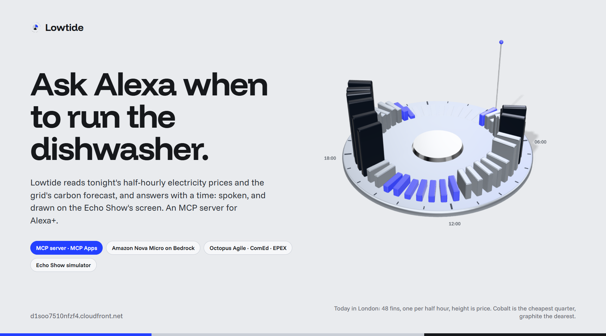

# Lowtide

**Ask Alexa when to run the dishwasher. Lowtide answers from tonight's real electricity prices.**

An MCP server for Alexa+ that reads every half-hourly price and the grid's carbon forecast,<br>
and plans the dishwasher, the washing, the hot water and the car for the cheapest, cleanest time.

[](https://d1soo7510nfzf4.cloudfront.net)
[](https://d1soo7510nfzf4.cloudfront.net/connect)
[](https://d1soo7510nfzf4.cloudfront.net/echo)
[](#engineering-notes)
[](#runs-on-aws)
[](https://github.com/RohanGlitched/lowtide/actions/workflows/ci.yml)
[](LICENSE)

[**Try it on the Echo**](https://d1soo7510nfzf4.cloudfront.net/echo) · [**Watch the demo (2:54)**](https://youtu.be/LOHfsCr-m8Y) · [Add it to Claude or ChatGPT](https://d1soo7510nfzf4.cloudfront.net/connect) · [Today's prices, region by region](https://d1soo7510nfzf4.cloudfront.net/tables)

</div>

---

## The problem

Millions of homes now pay a different price for electricity every half hour: Octopus Agile in Britain, ComEd Hourly Pricing in Illinois, and dynamic tariffs in Germany, where every supplier has had to offer one to smart-meter customers since 1 January 2025 ([EnWG §41a](https://www.gesetze-im-internet.de/enwg_2005/__41a.html)). Britain is moving every meter to half-hourly settlement, and suppliers must finish by 7 May 2027 ([Ofgem, P487 decision](https://www.ofgem.gov.uk/sites/default/files/2026-05/decision-to-approve-BSC-P487-Incentive-on-BSC-Supplier-Parties-to-meet-the-M15-MHHS-Milestone.pdf)).

The money is in the big loads. On 15 October 2026 in London, charging a car (22 kWh) at Agile's cheapest time cost **£4.25 instead of £7.30** at a typical time of day, and heating a 6 kWh hot-water cylinder cost **£1.16 instead of £1.97**. Twice a week for the car and daily for the water, that is about **£610 a year from two habits** if every day were like that one. The baseline is a typical start (the average of every start time in the next 24 hours), not the evening peak; [`web/scripts/impact.ts`](web/scripts/impact.ts) prints today's figures for any postcode. The grid gains too: the car is 7.3 kW of load moved out of the evening, the immersion heater 3 kW.

But nobody reads a price table while plugging in the car or loading the dishwasher. The question is always the same, and it's asked out loud with your hands full: **"When should I run it?"** That's a voice question. Lowtide is the answer.

## What it does

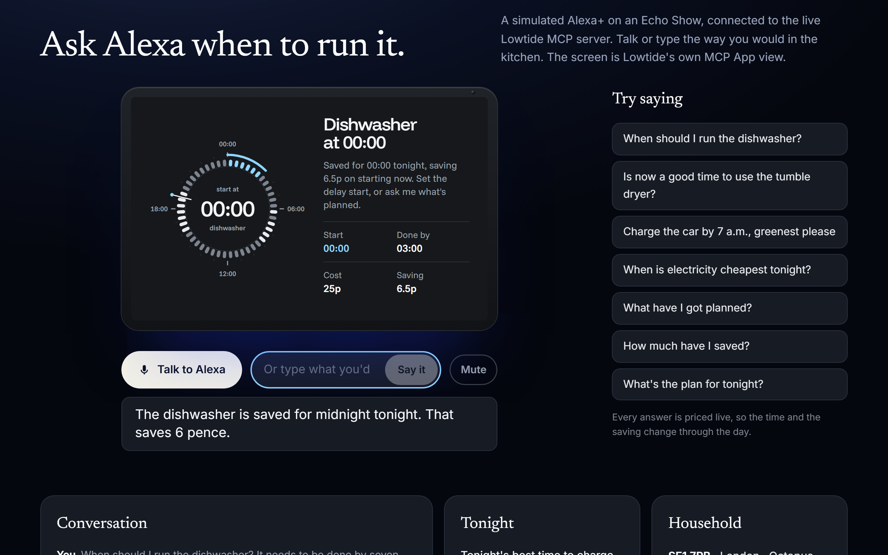

> **You:** Alexa, when should I run the dishwasher? It needs to be done by seven.
> **Alexa:** The dishwasher should run tonight at 1 a.m. It costs about 23 pence, 7 pence less than starting now. Would you like to save it?
> **You:** Yes please.
> **Alexa:** The dishwasher is scheduled to run tonight at 1 a.m. That saves 7 pence.

That exchange is real: Amazon Nova Micro on Amazon Bedrock, calling Lowtide's MCP tools, with London's live Agile prices. The answer comes back twice: **a sentence to speak**, and **an MCP App view for the Echo Show screen**, the next 24 hours on a dial with the run marked on the rim.

- **Plans any shiftable load** (dishwasher, washing machine, tumble dryer, EV, immersion heater, home battery), with a deadline ("done by seven"), an earliest start ("not before ten"), and a goal: cheapest, greenest, or both.
- **Remembers the household:** saved runs and money saved, behind a private household link (no account; a name is optional and never required).
- **Real prices everywhere:** Octopus Agile for every British postcode (all 14 regions), ComEd day-ahead hourly prices for northern Illinois, EPEX day-ahead for Germany, and the National Energy System Operator's regional carbon forecast.

## The day, machined

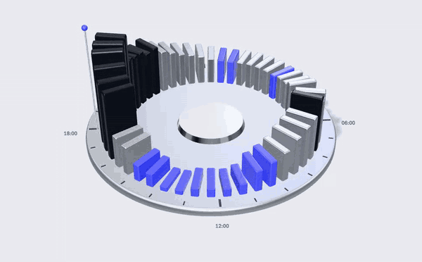

The website turns each day into an object: a studio-lit ring of 48 aluminium fins (three.js), one per half hour, height = price. The cheapest quarter is anodised cobalt, the dearest graphite, and a polished pin stands at "now". Switch city and it re-cuts itself from that region's live prices. The Echo's screen shows the same object from above.

## Try it in one minute

1. Open **[d1soo7510nfzf4.cloudfront.net/echo](https://d1soo7510nfzf4.cloudfront.net/echo)**. A demo household in London is set up for you, with two weeks of past runs priced at the real rates of those nights.
2. Press **Talk to Alexa** (or type). Try: *"When should I run the dishwasher?"*, then *"Yes please"*, then *"How much have I saved?"* The engine line under the conversation says what is understanding you: Amazon Nova Micro on Amazon Bedrock, or Lowtide's own phrase router when Bedrock isn't reachable.
3. Watch the right-hand column: every MCP tool call Alexa makes is listed as it happens.
4. Want it in your own assistant? **[Make a household link](https://d1soo7510nfzf4.cloudfront.net/connect)** and add it to Claude (Settings → Connectors → Add custom connector) or ChatGPT (developer mode → Create).
5. Or open it in **[Countertop](https://d124pgg01fg3le.cloudfront.net/?server=https://d1soo7510nfzf4.cloudfront.net/api/mcp)**, the open-source voice and screen test bench for MCP servers that came out of this project ([source](https://github.com/RohanGlitched/countertop)).

## Screens

| | |
|---|---|
| 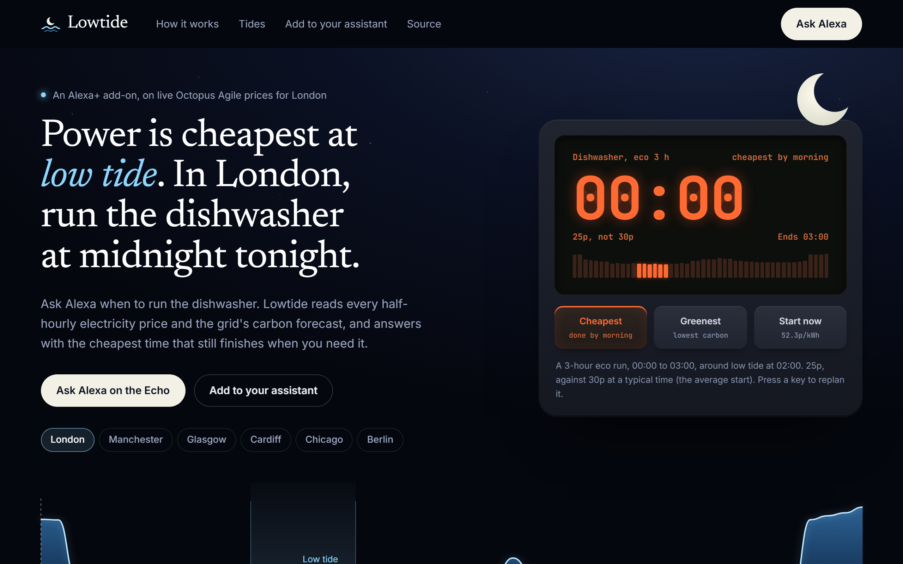 | 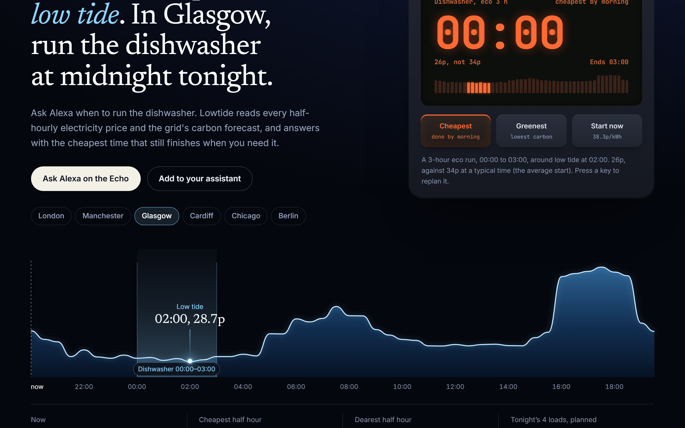 |
| **Home.** The headline is live data; the ring is the next 24 hours in London. | **Glasgow.** Every region gets a different object every day. |
| 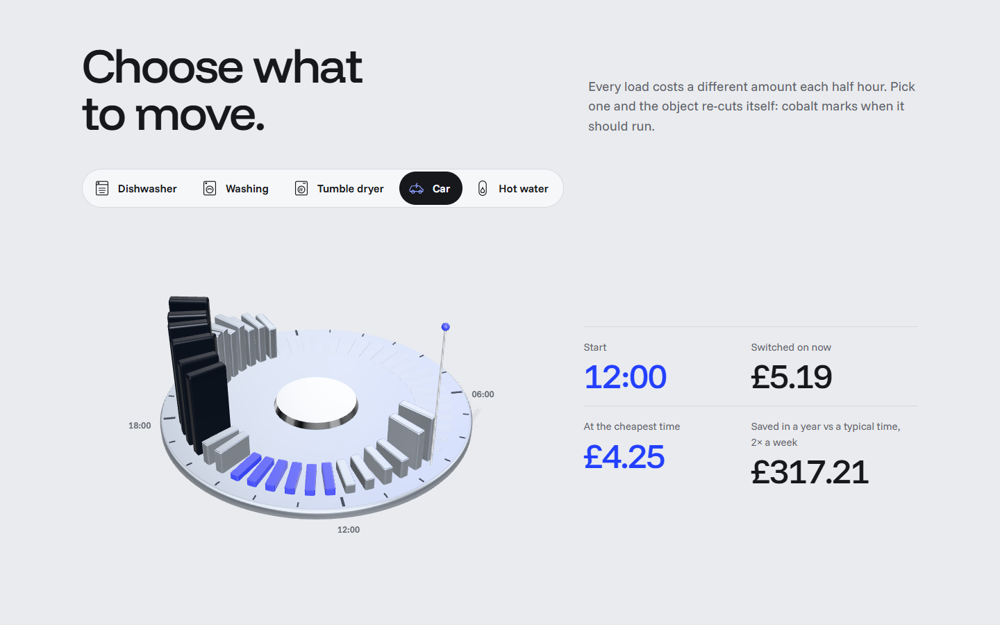 | 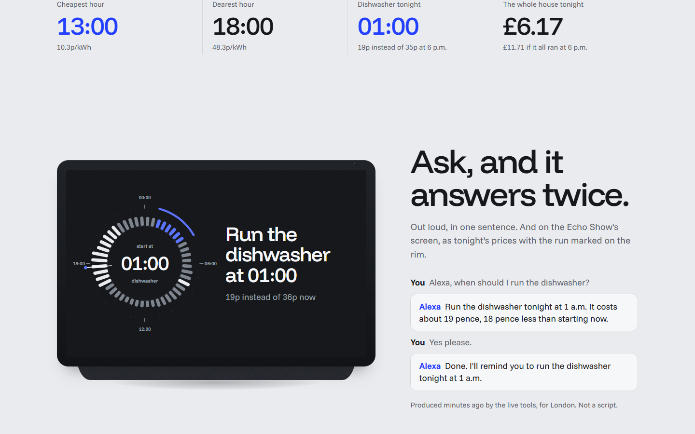 |
| **Choose what to move.** Pick a load; cobalt marks when it should run, with the saving. | **Ask, and it answers twice.** The live answer for London, spoken and drawn. |
| 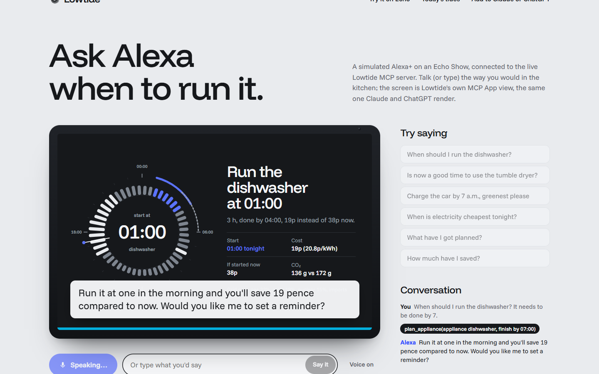 | 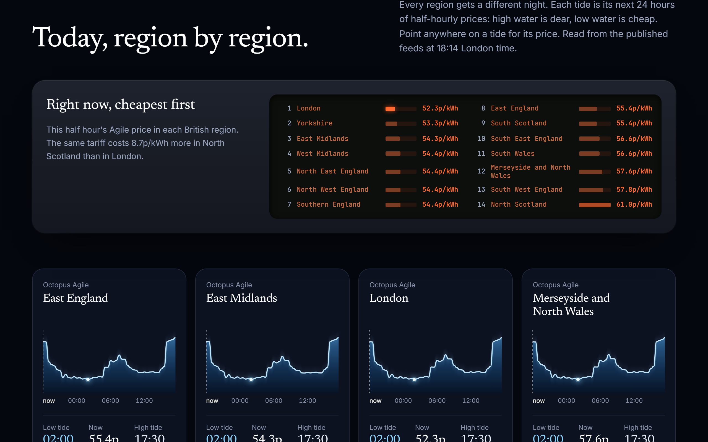 |
| **Echo simulator.** Bedrock picks the tool; the MCP App view renders on the screen. | **Today, region by region.** 14 Agile regions, Illinois and Germany. |

<p align="center">
  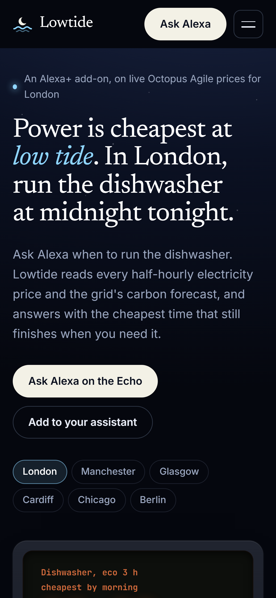
  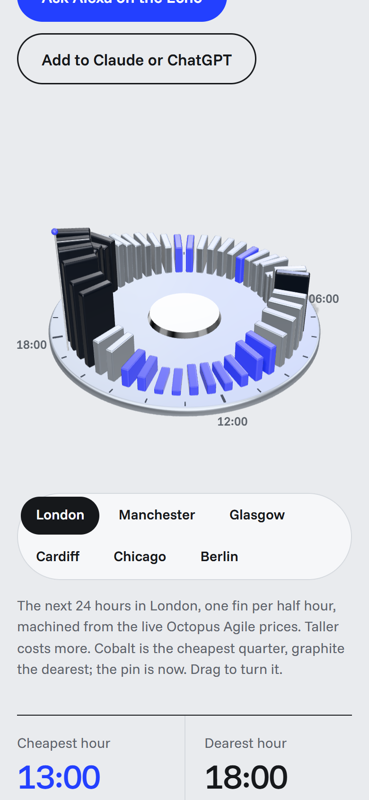
  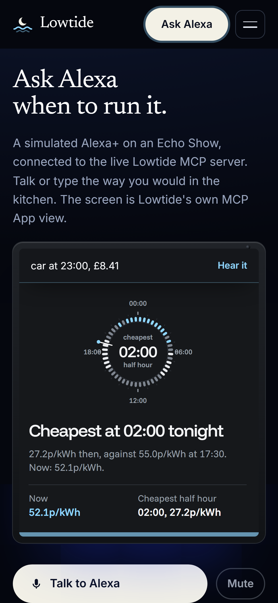
</p>

## How it works

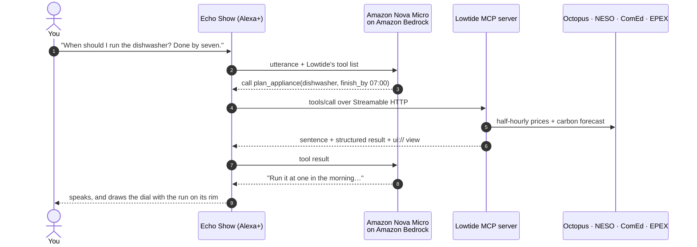

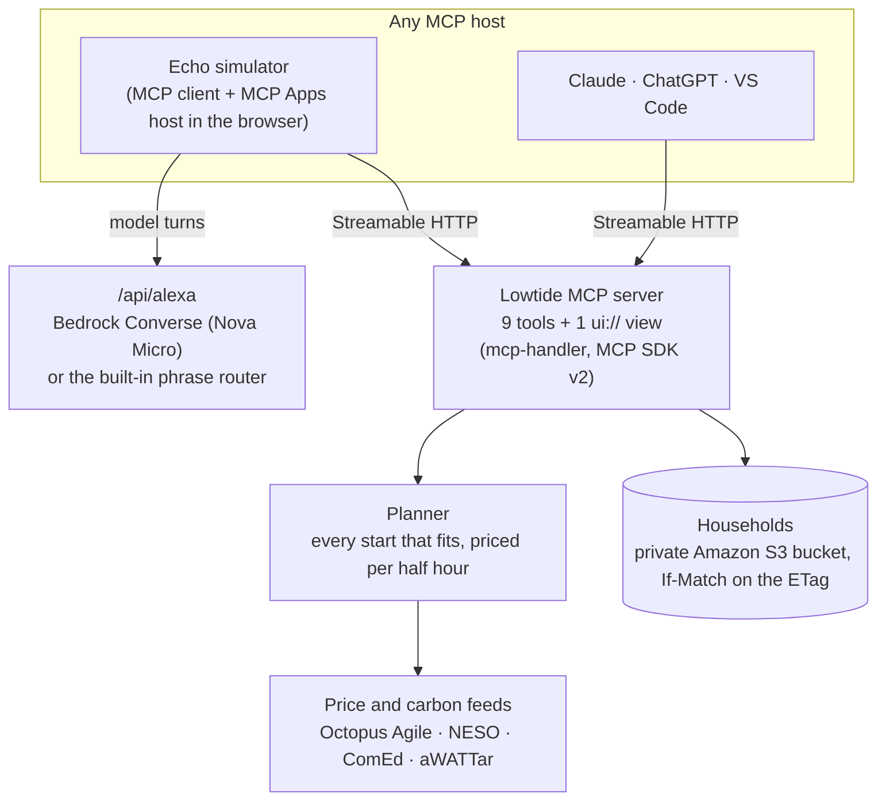

### The tools

| Tool | What it does | Shows a view |
|---|---|---|
| `plan_appliance` | Cheapest or greenest start for a load, with an optional deadline and earliest start; compares with starting now. "Done by seven" asked at half past six means tomorrow morning | ✓ |
| `schedule_run` | Saves the run once the person agrees, with its saving (it keeps the plan; it doesn't switch anything on). On hosts that can show a form (MCP elicitation, 2026-07-28) the person confirms on screen; elsewhere the spoken "yes" counts | ✓ |
| `check_now` | Whether this half hour is cheap or dear, and when it drops; name an appliance and it prices that load now against its best later start | ✓ |
| `get_tide` | The next 24 hours of prices and carbon, with the cheapest and dearest hours; `after: "18:00"` answers "tonight" | ✓ |
| `list_runs` / `cancel_run` | The household's planned runs | ✓ |
| `get_savings` | Money and CO₂ saved by running at the cheap hours | ✓ |
| `set_home` | Postcode or city, which picks the tariff region | |
| `get_tonight` | Tonight's plan, made once a night as soon as tomorrow's prices are published: the best start for each appliance the household uses, and whether tonight is unusually cheap. Also a resource, `lowtide://household/tonight` | ✓ |

Every tool returns a **voice-ready sentence** first (times said the way people say them, money in pence or cents), a **structured result** for the view, and, for `plan_appliance`, a line the model uses for `schedule_run` but never reads aloud. The server ships its own instructions, and the repo ships an **Agent Skill** ([`skills/lowtide/SKILL.md`](skills/lowtide/SKILL.md)) for skills-aware agents.

### Built for a voice device

- **The answer leads.** "Run the dishwasher at 01:00" is the headline on screen and the first words spoken.
- **Readable across a kitchen.** The view has a fullscreen layout for device screens (sized from the screen, nothing scrolls) and an inline one for chat hosts.
- **Never stuck.** If Bedrock is unavailable or the daily budget is spent, the simulator falls back to a deterministic phrase router that calls the same tools, and the tools' own sentences are spoken. The page says which one is answering, from a real probe, not from whether a key is set.
- **A real voice.** Replies are spoken by Amazon Polly's neural voices, chosen by tariff region: Amy (British English) for Agile, Joanna (American English) for ComEd, Vicki (German) for EPEX. Plain text only, no SSML, so nothing in a tool result can change how it is said; capped per visitor and per day in characters, cached by a hash of the sentence. If Polly is unreachable the browser's own speech takes over, and the page labels whichever voice actually spoke.
- **Proactive, on a schedule.** An Echo shows a waiting notification as a yellow light. Lowtide's version: Octopus publishes tomorrow's prices at about 4 p.m. UK time, and Amazon EventBridge Scheduler runs tonight's plan at 16:45 and again at 18:30 London time, planning the coming night for every saved household, once, and storing it with the household (If-Match, like every write); the Echo pulses yellow and shows "Tonight is unusually cheap: tumble dryer at 02:00" until you hear it. The 18:30 run catches a late publication or households the first run had no time for. If a schedule is ever missed, the lazy roll still covers it: the first request after the prices are out plans that household, and each request takes one short, bounded step through the others.
- **A chain of models.** The server asks for Amazon Nova Micro first, the cheapest Bedrock model with tool use, through the Asia Pacific inference profile in Sydney; if the account can't call it (model access, an organisation policy, a region rule), it tries Nova Lite and remembers what worked. Nova's `<thinking>` text is stripped, so Alexa never reads it aloud.
- **Signed requests, no SDK.** Bedrock, S3 and Polly are all called with SigV4-signed requests from one small signer in `node:crypto` ([`web/lib/aws/sigv4.ts`](web/lib/aws/sigv4.ts), checked in tests against botocore's signatures). On AWS the credentials are the Lambda function's own role (temporary, with a session token, nothing stored anywhere); its policy allows `InvokeModel` on Nova Micro and Nova Lite, get, put and list on the households bucket, and `SynthesizeSpeech`. The first deployment, on Vercel (lowtide-energy.vercel.app, whose pages now redirect to AWS), uses two single-purpose IAM users instead, because the organisation denies the OIDC provider that keyless access from Vercel would need.
- **Bounded cost.** The model route answers only its own pages, checks every message shape, and caps calls at 40 per visitor per 10 minutes and 250 per visitor per day (per server instance), plus 1,500 a day in all (a count shared through the S3 store, synced every 20 calls and on every call once 80% is spent). The same-origin check stops casual reuse but is not authentication, so the caps are the real guard.

## Runs on AWS

Lowtide runs on AWS at **[d1soo7510nfzf4.cloudfront.net](https://d1soo7510nfzf4.cloudfront.net)** (MCP endpoint: `https://d1soo7510nfzf4.cloudfront.net/api/mcp`). Everything it needs is in one CloudFormation stack in Sydney (ap-southeast-2), deployed by [`infra/deploy.py`](infra/deploy.py) from [`infra/template.yaml`](infra/template.yaml): no servers, no containers, no static keys, sized for the free tier.

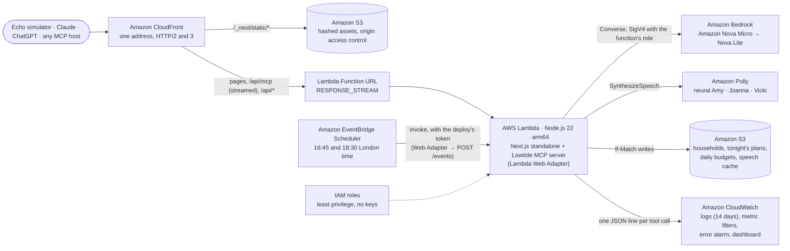

| AWS service | What it does for Lowtide | Why this one |
|---|---|---|
| **AWS Lambda** (Node.js 22, arm64) | Runs the whole Next.js app: the website, the MCP server (Streamable HTTP), the model, voice and household routes | Pay per request and free at demo scale; arm64 is cheaper per millisecond; nothing to patch |
| **Lambda Function URL** in response-streaming mode, with the **Lambda Web Adapter** | Turns HTTPS requests into requests to the Next.js server and streams the answers back, so MCP's server-sent events arrive as they are written | No API Gateway needed, and streaming is what MCP's Streamable HTTP expects |
| **Amazon CloudFront** | The one public address: caches `/_next/static` for a year and pages only as long as Next.js says, never caches `/api/*`, hands the function the visitor's host | TLS, HTTP/3 and edge caching in front of a function that may be cold |
| **Amazon S3** | Static assets (through origin access control, the bucket stays private) and, in a second bucket, every household as one JSON object with `If-Match` on the ETag | Conditional writes give safe read-modify-write without a database; a few cents a month |
| **Amazon Bedrock** (Converse API, Amazon Nova Micro, APAC inference profile) | Every turn of the Echo simulator: picks the Lowtide tool, then words the answer | The cheapest Bedrock model with tool use, answering in about a second from Sydney |
| **Amazon Polly** (neural voices) | Speaks every Echo reply and tonight's notification in the household's region's voice | Natural speech that is the same on every browser, which Web Speech is not |
| **Amazon EventBridge Scheduler** | Two schedules, `lowtide-web-tonight-1645` and `lowtide-web-tonight-1830` (cron in `Europe/London`, flexible window off, 2 retries), invoke the function after Octopus publishes tomorrow's prices; the Lambda Web Adapter hands the event to `POST /events`, which plans tonight for every household within a time budget and logs one summary line | Tonight's plan is ready before anyone asks, on London's clock through both clock changes, with no server or rule to run; the lazy roll on ordinary requests stays as the fallback |
| **Amazon CloudWatch** | One JSON log line per tool call, model turn, Polly request, nightly roll and scheduled run; ten metric filters turn them into tool calls, errors, Bedrock latency, Polly characters, tonight's plans and scheduled runs, failures and households planned on a dashboard; an alarm on Lambda errors | Seeing what judges and users actually do, at no cost |
| **AWS IAM** | Two roles: the execution role (`bedrock:InvokeModel` on Nova Micro and Lite only, the households bucket only, `polly:SynthesizeSpeech`) and `lowtide-web-scheduler`, which EventBridge Scheduler assumes and which may only invoke this one function | No access keys exist for the AWS deployment at all |
| **AWS CloudFormation** | The whole stack (28 resources, the two schedules and their role included) from one template; `deploy.py` packages, uploads, deploys and invalidates in one command, with `--dry-run` to build and validate offline | Repeatable, and deletable in one step after judging |

Countertop, the open-source test bench, has its own small stack on the same pattern ([`countertop/infra`](https://github.com/RohanGlitched/countertop/tree/main/infra)): the static site in S3 behind CloudFront, and its model function on Lambda under `/api/turn`, with a role that may only call Nova Micro and Nova Lite.

Deploying it yourself (any account; Python 3.12 with boto3, Node.js 22; credentials from the usual AWS environment):

```bash
python infra/deploy.py --dry-run     # build, package and validate the template; no AWS calls
python infra/deploy.py               # create or update the stack, upload assets, invalidate, smoke-test
```

## Engineering notes

- **MCP:** `mcp-handler` 2 with MCP SDK v2 serves the 2026-07-28 spec natively and falls back to 2025-era stateless Streamable HTTP from the same route. One endpoint per household (`/api/mcp/h/<id>`), plus a guest endpoint for questions that name a place.
- **MCP Apps:** the `ui://lowtide/tide-chart.html` resource is one self-contained HTML file (esbuild), using `@modelcontextprotocol/ext-apps`. The Echo simulator hosts it in an opaque-origin sandboxed iframe through `AppBridge`, the same protocol Claude and ChatGPT use.
- **Prices:** Agile rates by region letter (postcode → grid supply point), NESO regional carbon by region id, ComEd's day-ahead feed parsed from Chicago wall-clock time, aWATTar EUR/MWh → ct/kWh. Feeds are cached two minutes and fail one at a time.
- **Planner:** every half-hour start that finishes in time is priced by spreading the load evenly over the slots it covers (partial slots included); "balanced" normalises cost and carbon distance from each optimum. Negative prices count as a credit.
- **Storage:** one JSON object per household in a private Amazon S3 bucket in Sydney, the same region as Bedrock, with all public access blocked. Every update is a read-modify-write guarded by S3's `If-Match` on the object's ETag, so two quick saves from two devices can't silently overwrite each other; a conflict re-reads and retries with backoff, and one that still conflicts says "try again" rather than overwriting. The store sits behind a small interface (`web/lib/storage.ts`) with Google Cloud Storage and Vercel Blob as alternatives; Lowtide started on Blob and moved to S3 when the Hobby account's shared monthly Blob allowance ran out during the submission period and took every household with it. On S3 the whole thing costs cents: small JSON objects and a few thousand requests a month.
- **Households are capability links, not accounts (a deliberate choice).** A household is `/api/mcp/h/<id>`, ten random base-32 characters (about 50 bits), and holds only a place and its planned runs: no name required, no address, no payment details. Alexa+ account linking isn't open to outside developers for MCP integrations yet, and a link works in every MCP host today. The production path is the MCP specification's authorization flow (OAuth 2.1 with PKCE, Lowtide as a protected resource), with the energy supplier as the identity provider, so a household signs in once with the account it already has.
- **Savings are quoted against a typical start.** Every saving on the website compares the cheapest start with the average of every start time in the next 24 hours (`typicalCost` in `web/lib/plan.ts`), not with the evening peak, and the page says so. The voice tools compare with starting now, and say that too.
- **Tonight's plan on a schedule:** EventBridge Scheduler targets the Lambda function directly with a fixed JSON Input; the Lambda Web Adapter passes any non-HTTP event to `POST /events` (`AWS_LWA_PASS_THROUGH_PATH`). That route accepts only an event carrying a random token that `deploy.py` generates on every deploy and that lives in just two places, the function's environment (`SCHEDULE_TOKEN`) and the schedules' Input, compared in constant time. A header check can't do this job: Next.js adds `x-forwarded-*` headers to every request it serves, the adapter's loopback call included, so the first version refused the real scheduled call (friction log 14). CloudFront returns 404 for `/events`. Verified on 15 October 2026: invoked with the schedule's own Input, the function answered `{"ok":true,"night":null,…}` (at 13:03 BST tomorrow's prices weren't out yet, so the job waits for the next run) and CloudWatch logged `{"evt":"schedule","job":"tonight","ok":true,…}`. Every step is idempotent and guarded by If-Match, so the two runs, a retry and a visitor's lazy step never plan a household twice.
- **Performance:** the 3D object renders on demand (static shadow map, 30 fps idle turn, paused off screen), compiles shaders asynchronously, and mounts in idle time.

## Proof

| Claim | Where it's checked |
|---|---|
| The planner picks the cheapest and greenest windows, respects deadlines, handles partial slots and negative prices | [`web/test/plan.test.ts`](web/test/plan.test.ts) |
| Asked for the cheapest time, it never recommends a start dearer than starting now; a greener pick that costs more says so out loud ("about 5 pence more than starting now, but 5% less carbon"), for every appliance and goal across a day of real Agile, ComEd and EPEX prices | [`web/test/now.test.ts`](web/test/now.test.ts) |
| Times survive DST and time zones (the London and Chicago clock changes, ComEd's repeated hour); "7am", "7:30 p.m.", "noon" and ISO all parse | [`web/test/time.test.ts`](web/test/time.test.ts), [`web/test/edges.test.ts`](web/test/edges.test.ts) |
| Edge cases hold: deadlines rolled to the next morning, refusals never schedule, past starts refused, negative prices, partial slots, abuse limits on the household and model routes | [`web/test/edges.test.ts`](web/test/edges.test.ts), 50 tests, including the real tool handlers and routes in-process |
| Postcodes and cities resolve to the right tariff; money reads naturally | [`web/test/time.test.ts`](web/test/time.test.ts) |
| The fallback router maps everyday phrasings, and "yes" schedules the plan just offered | [`web/test/fallback.test.ts`](web/test/fallback.test.ts) |
| Every tool works over Streamable HTTP against the live deployment (a tool error fails the build) | [`web/scripts/mcp-smoke.mjs`](web/scripts/mcp-smoke.mjs), run in CI |
| A full Bedrock conversation (plan → schedule → savings) works in production | [`web/scripts/alexa-turn.mjs`](web/scripts/alexa-turn.mjs) |
| The Echo flow works on desktop and phone with no console errors | [`web/scripts/e2e.cjs`](web/scripts/e2e.cjs) |
| `schedule_run` asks through MCP elicitation when the client can show a form, saves nothing on "decline", and keeps the spoken yes for clients that can't (real SDK client, in-process) | [`web/test/elicit.test.ts`](web/test/elicit.test.ts), live: [`web/scripts/elicit-smoke.mjs`](web/scripts/elicit-smoke.mjs) |
| SigV4 matches botocore for Bedrock, S3 and Polly, with and without a session token; credentials come from the Lambda role on AWS and never from Vercel's own AWS variables | [`web/test/aws.test.ts`](web/test/aws.test.ts) |
| `/api/speak` serves Polly audio only to the site's own pages, in the region's voice, cached by text, within per-visitor and daily caps, and fails over to the browser's voice | [`web/test/aws.test.ts`](web/test/aws.test.ts) (Polly replaced by a fake) |
| Tonight's plan waits for tomorrow's prices, is computed once per household per night even when two instances race (If-Match), and the roll walks households a few at a time, skipping quiet ones; the scheduled job runs the roll to the end within its time budget, and `/events` refuses any event without this deploy's schedule token (missing, wrong or unconfigured) | [`web/test/aws.test.ts`](web/test/aws.test.ts) |
| Savings are quoted against a typical start, not the peak | [`web/test/plan.test.ts`](web/test/plan.test.ts) (`typicalCost`), live figures: [`web/scripts/impact.ts`](web/scripts/impact.ts) |
| Latency on AWS, measured on 15 October 2026 from India through CloudFront to Lambda in Sydney, four questions over two conversations: each Bedrock turn (`/api/alexa`) 1.0–1.3 s; a read-only tool over MCP 0.3–0.5 s; `schedule_run` 0.9 s (S3 read plus conditional write); a whole answered question (two model turns and a tool) 2.6–3.3 s. Amazon Polly: 1.3 s to the first byte of new speech, 1.0 s from the cache (a miss, Polly plus storing the audio in S3, adds about 0.35 s). Pages: 75–100 ms from the CloudFront edge, 0.9–1.2 s when rendered by Lambda (one 4.9 s outlier) | [`web/scripts/alexa-turn.mjs`](web/scripts/alexa-turn.mjs), `curl -w` timings |

## Run it

```bash
cd web
npm install
npm run dev          # builds the MCP App view, then starts Next.js
npm test             # 100 tests: planner, clocks, places, the phrase router, the tool handlers, the routes, SigV4, Polly, tonight's plan
node scripts/mcp-smoke.mjs http://localhost:3000
```

Optional environment (see [`web/.env.example`](web/.env.example)): `S3_BUCKET` + `S3_REGION` with `AWS_ROLE_ARN` or `S3_ACCESS_KEY_ID` + `S3_SECRET_ACCESS_KEY` (households in a private Amazon S3 bucket next to Bedrock, written with `If-Match` on the ETag so two quick saves can't overwrite each other; a GCS bucket or `BLOB_READ_WRITE_TOKEN` also work; without any store they're stored in `web/.data`), `BEDROCK_ACCESS_KEY_ID` + `BEDROCK_SECRET_ACCESS_KEY` (the simulator's model, called with signed requests to `bedrock-runtime.<region>.amazonaws.com` and nowhere else; without them the phrase router answers), `BEDROCK_REGION` (default `ap-southeast-2`), `BEDROCK_MODEL`.

## What's next

- Matter smart plugs and appliance APIs, so a confirmed plan can start the machine itself.
- More tariffs: Octopus Go and Intelligent, PG&E time-of-use, Tibber; and WattTime carbon for the US.
- Real push to the device: tonight's plan is already computed on a schedule before anyone asks, but reaching a real Echo needs Alexa+ to open proactive notifications to MCP integrations (today the Echo simulator shows it as a waiting notification when you open it).

## Who pays

The household keeps the saving, but the natural buyer is the energy supplier. Suppliers with time-of-use tariffs need load moved out of the evening peak, and Britain already pays for it: the National Energy System Operator's Demand Flexibility Service had 2.46 million households and businesses signed up by March 2026, and since then the service also covers turning demand *up* when power is plentiful, not only down ([NESO, 25 March 2026](https://www.neso.energy/neso-announces-shakeup-new-look-demand-flexibility-service)). In winter 2024/25 it shifted 3,917.7 MWh and paid £943,983 to providers ([NESO](https://www.neso.energy/nearly-2-million-households-and-businesses-registered-demand-flexibility-service-dfs-last-winter)). NESO pays the providers, and each provider decides how to reward its customers. Alexa+ MCP integrations are open to brands, so the route to market is a supplier-branded Lowtide: the supplier's tariff and flexibility events in, one spoken sentence and a screen out, at the moment someone is standing at the machine.

## Feedback for the Amazon teams

The friction we hit while building is logged in [`FRICTION.md`](FRICTION.md).

---

Built for the [Amazon Build, Ship, Shape hackathon](https://amazonappdev2026.devpost.com) (Alexa+ track, AWS Builder mini challenge), October 2026. Prices: Octopus Energy, ComEd, aWATTar; carbon: National Energy System Operator. Not affiliated with Amazon, Octopus Energy or ComEd.

MIT licensed.
